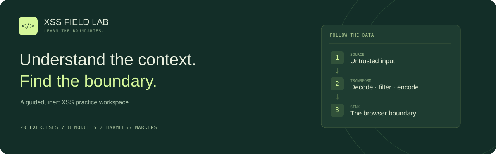

<p align="center"></p>

<p align="center"><strong>20 exercises · 8 modules · Zero runtime dependencies · Inert proof markers</strong><br>A focused workspace for learning XSS recognition, browser contexts and precise evidence.</p>

<p align="center"><a href="#quick-start">Quick start</a> · <a href="#learning-path">Learning path</a> · <a href="#kali--codex-coach">Kali + Codex coach</a> · <a href="docs/README.ar.md">العربية العراقية</a> · <a href="docs/ARCHITECTURE.md">Architecture</a></p>

## Practice with precision

Follow a marker from its source to its output boundary. Predict what happens, run a safe teaching model, inspect the result, then understand the repair.

- A responsive, forest-green workspace with module navigation and an inspectable data-flow trace.
- Progressive hints, a reset for every exercise and a completion explanation with the relevant fix.
- Separate write/read steps for stored content and a one-step decoder for DOM flow analysis.
- Script-free browser previews, fixed inert markers and modeled CSP decisions.
- Browser-local progress and an autosaved journal, with a complete reset control.
- A companion `xss-field-coach` skill for guided sessions in Codex on Kali Linux.

The illustrations and interface share the same visual system. The cover above is repository artwork, not a browser screenshot.

## Quick start

Clone your copy, enter the checkout, then serve the static files over loopback:

```bash
cd xss-field-lab
python3 -m http.server 8000 --bind 127.0.0.1 --directory dist
```

Open **http://127.0.0.1:8000**. Stop the server with **Ctrl+C**. Open through HTTP because the app uses JavaScript modules. Python 3 is enough to serve it; no build or npm install is needed.

The owner-hosted version uses access control provided by its hosting platform. A copy of this repository does not include that sign-in layer. Serve your copy over loopback or add access control before remote hosting.

## Learning path

| Module | Exercises | What you practice |
| --- | ---: | --- |
| Fundamentals | 2 | Reflection, delivery patterns and evidence boundaries |
| Reflected XSS | 3 | HTML text, quoted attributes and JavaScript context recognition |
| Stored XSS | 2 | Separate write/read observations and protecting every renderer |
| DOM-based XSS | 3 | Sources, sinks, one-step decoding and a safe sink repair |
| Output encoding | 3 | Text, attributes and validated URL handling |
| Filters & sanitizers | 2 | Parser mismatch and rich-content policy |
| Content Security Policy | 3 | Inline scripts, nonces and report-only behavior |
| Debugging & evidence | 2 | Response vs live DOM and a stored-to-DOM capstone |

Every exercise is available from the sidebar. Follow the recommended order or revisit a specific context. Progress is stored on one browser/device; it is not synchronized to the repository.

## Kali + Codex coach

The repository includes `.agents/skills/xss-field-coach/`. Current Codex discovers repository skills from `.agents/skills`, so you can launch it in this checkout and invoke:

```text
$xss-field-coach
درّبني على المختبر خطوة بخطوة، اشرح بالعراقي، وخليني أتوقع النتيجة قبل الحل.
```

To make the coach available outside this checkout:

```bash
bash scripts/install-skill.sh
```

This copies the skill into `~/.agents/skills/xss-field-coach` without sudo, network access or overwriting an existing install. Restart Codex if it does not appear. For a different discovery directory supported by your installed Codex version, use `--skills-dir /absolute/path/to/skills`.

The coach guides practice, reviews supplied code/HTTP/DOM evidence and distinguishes reflection, HTML injection and actual execution evidence. It does not fine-tune a model or promise mastery or vulnerability discovery.

See [OpenAI skill discovery documentation](https://learn.chatgpt.com/docs/build-skills) and [the Iraqi Arabic guide](docs/README.ar.md).

## Checks

Node.js 22+ is needed only for development checks:

```bash
npm test
npm run check
```

The regression suite covers correct and incorrect answers for all exercises, partial selections, write/read separation, decoder failures, filter mismatch, encoding, saved-state restoration, resets and hostile-looking input escaping. The installer is tested in temporary directories. CI runs the same commands.

Automated source/model tests and live browser QA are reported separately. No browser visual QA was available in the authoring environment.

## Simulation boundary

Learner input is never passed to `eval`, `Function`, a script element or an active event attribute. A deterministic model recognizes the lab's inert proof notation. The preview is an iframe with an empty sandbox permission list and a CSP blocking scripts, connections, forms and external resources. Only fixed, trusted proof markup can be rendered; learner strings are escaped.

A highlighted `MRTD` element demonstrates a modeled HTML boundary change. It does not establish JavaScript execution. CSP exercises model specific decisions; the engine is not a complete browser parser, CSP implementation or production sanitizer.

Read [the architecture and security boundaries](docs/ARCHITECTURE.md) before extending the engine.

## Repository layout

```text
dist/                    Static interface, curriculum and inert teaching model
tests/                   Node.js regression suite
.agents/skills/           Installable XSS Field Coach skill
scripts/install-skill.sh  Local, non-overwriting user skill installer
docs/                    Architecture, Arabic guide and repository artwork
.github/                 CI, issue form and pull-request template
```

## Hosting and privacy

The repository can be kept private while the existing owner-hosted lab remains available through its access-controlled URL. GitHub repository visibility and website visibility are independent. GitHub Pages can expose a site publicly even when its source repository is private; no Pages deployment is enabled here. See [GitHub's publishing guidance](https://docs.github.com/en/pages/getting-started-with-github-pages/creating-a-github-pages-site).

## Contributing

Read [CONTRIBUTING.md](CONTRIBUTING.md). Keep learner strings inert, preserve the sandbox, use stable exercise IDs and add regression checks for behavioral changes. Report a sandbox escape privately as described in [SECURITY.md](SECURITY.md).

Created for Mortada's XSS practice. No open-source license has been selected.
